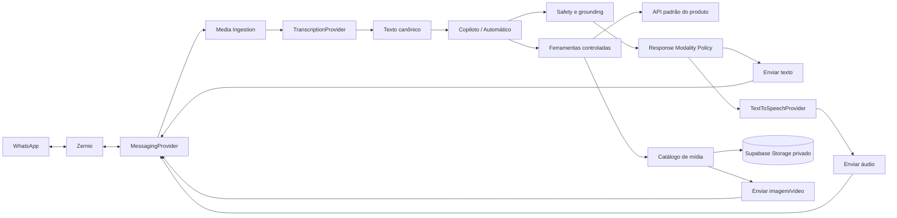
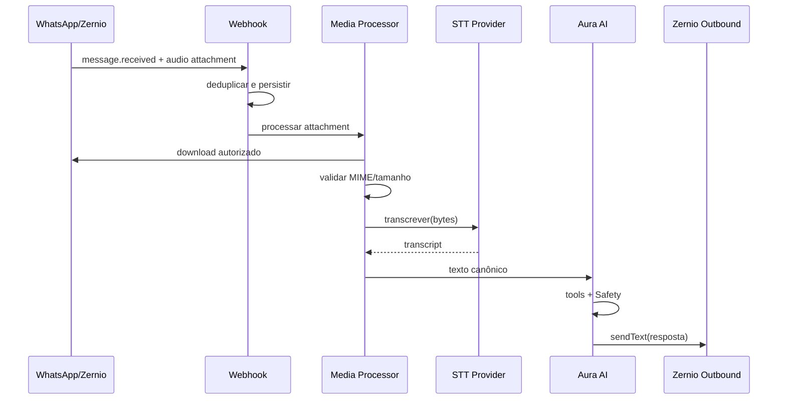
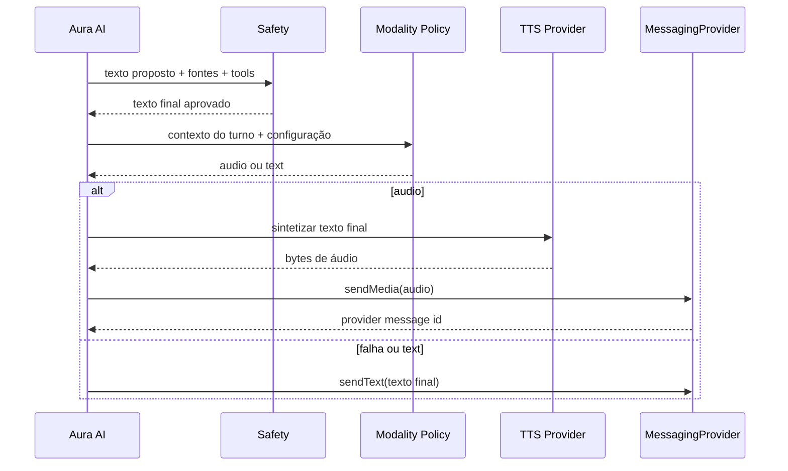

# Roadmap — Mensageria Multimodal da Aura IA

**Status:** proposta para estudo e execução gradual  
**Atualizado em:** 8 de novembro de 2026  
**Base analisada:** `main` no commit `f680c91`  
**Escopo:** áudio recebido, transcrição, mídia curada e resposta em áudio no WhatsApp

## 1. Visão do programa

A Mensageria Multimodal permitirá que a Aura:

1. receba áudios do WhatsApp, transcreva e responda inicialmente em texto;
2. selecione e envie fotos ou vídeos previamente aprovados, conforme o assunto da conversa;
3. transforme uma resposta textual já validada em áudio e a envie pelo WhatsApp;
4. mantenha as mesmas garantias atuais de isolamento por empresa, segurança clínica, auditoria e passagem para humano.

Este programa estende a arquitetura existente. A Aura continua sendo a proprietária do canal de WhatsApp e nunca acessa diretamente o banco de Clinova, Agenda+ ou Belariz. Dados dos produtos continuam chegando pela API padrão. Mídias administradas pela plataforma ficam no Supabase dedicado da Aura, isoladas por `workspace_id`.

## 2. Estado atual confirmado

O código atual já possui:

- webhook Zernio assinado e deduplicado por evento;
- persistência de mensagens e `attachments` em JSONB;
- histórico compartilhado pelo Copiloto e pelo modo Automático;
- envio textual e envio de templates via Zernio;
- provedores de LLM Anthropic e OpenAI;
- barreira de segurança antes do envio automático;
- consumo/créditos e eventos de uso de IA;
- isolamento lógico por `workspace_id` e tabelas fechadas por RLS;
- API padrão entre Aura e produtos.

Lacunas atuais:

- anexos viram apenas marcadores como `[cliente enviou um áudio]`;
- não existe download nem inspeção do conteúdo de mídia;
- não existe transcrição;
- não existe TTS;
- o outbound aceita somente texto e templates;
- não existe biblioteca de mídia ou bucket definido pelo projeto;
- não existe preferência de modalidade por empresa ou conversa;
- o uso da Zernio está centralizado em um cliente, mas ainda não há um contrato completo de mensageria multimodal.

## 3. Princípios e decisões

### 3.1 Princípios obrigatórios

1. **Texto validado é a representação canônica.** Transcrições e respostas faladas sempre possuem texto correspondente.
2. **O LLM nunca recebe credenciais, caminhos de Storage ou URLs privadas.** Ele solicita capacidades por ferramentas controladas.
3. **Safety antes de TTS e de mídia.** Uma resposta só pode virar áudio ou acionar mídia após validação factual e de segurança.
4. **Mídia ativa é curada.** A IA não pesquisa a internet nem escolhe arquivos arbitrários.
5. **Isolamento por empresa.** Toda consulta, objeto e evento inclui `workspace_id` derivado do contexto autenticado.
6. **Fallback textual.** Falha de TTS ou mídia nunca impede o envio do texto seguro.
7. **Fail closed para conteúdo clínico.** Na dúvida sobre autorização, validade ou consentimento, a mídia não é enviada.
8. **Idempotência por etapa.** Download, transcrição, síntese e envio não podem ser repetidos cegamente.
9. **Retenção mínima.** Bytes recebidos ou gerados são temporários, salvo quando fazem parte da biblioteca curada.
10. **Capacidades por provider.** A plataforma deve detectar o que a Zernio suporta sem assumir equivalência futura com a Meta direta.

### 3.2 Ordem recomendada

| Ordem | Épico | Dependência | Resultado utilizável |
|---|---|---|---|
| 1 | MM-0 — Fundação de Mídia | nenhuma | receber, validar, baixar e enviar mídia por contrato controlado |
| 2 | MM-1 — Áudio para Texto | MM-0 download | entender áudio e responder por texto |
| 3 | MM-2 — Biblioteca Curada | MM-0 outbound | enviar foto/vídeo certo para o assunto certo |
| 4 | MM-3 — Texto para Áudio | MM-0 outbound | responder por áudio com fallback textual |

## 4. Arquitetura-alvo



### 4.1 Contratos principais propostos

```ts
type MediaKind = 'audio' | 'image' | 'video' | 'document';

type ProviderAttachmentRef = {
  providerAttachmentId: string;
  providerMessageId: string;
  kind: MediaKind;
  mimeType?: string;
  fileName?: string;
  sizeBytes?: number;
  durationSeconds?: number;
};

type DownloadedMedia = {
  bytes: Uint8Array;
  mimeType: string;
  sizeBytes: number;
  fileName?: string;
};

interface MessagingProvider {
  capabilities(): Promise<MessagingCapabilities>;
  downloadAttachment(ref: ProviderAttachmentRef, signal?: AbortSignal): Promise<DownloadedMedia>;
  sendText(input: SendTextInput): Promise<ProviderSendResult>;
  sendMedia(input: SendMediaInput): Promise<ProviderSendResult>;
}

interface TranscriptionProvider {
  transcribe(input: TranscriptionInput, signal?: AbortSignal): Promise<TranscriptionResult>;
}

interface TextToSpeechProvider {
  synthesize(input: TextToSpeechInput, signal?: AbortSignal): Promise<SynthesizedAudio>;
}
```

## 5. Épico MM-0 — Fundação de Mídia do Canal

### 5.1 Objetivo

Criar a fronteira técnica única para download, validação e envio de anexos no WhatsApp, começando pela Zernio e preservando a troca futura por Meta Cloud API ou outro provedor.

### 5.2 Valor

- elimina a principal incerteza de integração;
- evita implementar STT, TTS e mídia curada acoplados à Zernio;
- centraliza limites, timeout, erros e observabilidade;
- permite testar mídia sem envolver o LLM.

### 5.3 Fora de escopo

- transcrever áudio;
- interpretar imagem;
- selecionar mídia por assunto;
- gerar áudio;
- oferecer upload na interface administrativa.

### 5.4 Casos de uso

#### UC-MM0-01 — Normalizar anexo recebido

**Ator:** webhook Zernio  
**Pré-condição:** evento assinado e não duplicado.  
**Fluxo principal:**

1. webhook recebe `message.received`;
2. adapter extrai os attachments reconhecidos;
3. cada attachment é normalizado sem guardar token ou URL secreta;
4. mensagem e referências são persistidas;
5. um evento interno de processamento é criado.

**Pós-condição:** o domínio conhece tipo, provider ID, MIME e metadados disponíveis.  
**Alternativas:** attachment desconhecido fica como `unsupported`, sem quebrar a mensagem textual.

#### UC-MM0-02 — Baixar mídia de forma segura

**Ator:** worker/processador de mídia  
**Fluxo principal:**

1. resolve mensagem, workspace, canal e provider;
2. verifica idempotência;
3. obtém o arquivo pela API do provider;
4. valida tamanho real, MIME detectado e allowlist;
5. devolve bytes somente em memória;
6. registra métricas sem conteúdo.

**Falhas:** expiração, 404, timeout, arquivo grande, MIME divergente e indisponibilidade viram códigos normalizados.

#### UC-MM0-03 — Enviar mídia em conversa aberta

**Ator:** API/serviço da Aura  
**Pré-condição:** janela de 24 horas aberta, canal conectado e mídia autorizada.  
**Fluxo:** valida → envia pela Zernio → persiste outbound → recebe status por webhook.

#### UC-MM0-04 — Descobrir capacidades do provider

O sistema informa se o provider aceita download de áudio, upload binário, envio por URL, imagem, vídeo, documento, áudio comum e voice note.

### 5.5 Requisitos funcionais

- RF-MM0-01: normalizar attachments sem depender do shape bruto fora do adapter Zernio.
- RF-MM0-02: suportar inicialmente `audio`, `image`, `video` e `document`.
- RF-MM0-03: validar allowlist de MIME por tipo.
- RF-MM0-04: validar tamanho pelo conteúdo real, não apenas pelo header.
- RF-MM0-05: aplicar timeout e limite de redirects no download.
- RF-MM0-06: impedir acesso a hosts não autorizados quando houver URL remota.
- RF-MM0-07: enviar mídia com caption opcional e idempotency key.
- RF-MM0-08: persistir status `pending`, `processing`, `processed`, `failed` ou `unsupported`.
- RF-MM0-09: registrar `provider_message_id` para reconciliar entrega.
- RF-MM0-10: manter envio textual atual sem regressão.

### 5.6 Requisitos não funcionais

- download e upload exclusivamente no backend;
- nenhum log com URL assinada, token ou bytes;
- limite configurável por tipo;
- timeout configurável, com `AbortSignal`;
- no máximo uma repetição para falha comprovadamente anterior ao envio externo;
- nenhuma repetição automática quando o resultado do envio for incerto;
- correlação ponta a ponta por `correlation_id`.

### 5.7 Modelo de dados potencial

```text
message_attachments
- id uuid PK
- workspace_id uuid NOT NULL
- conversation_id uuid NOT NULL
- message_id uuid NOT NULL
- provider_attachment_id text NOT NULL
- provider_message_id text
- kind text NOT NULL
- mime_type text
- file_name text
- size_bytes bigint
- duration_seconds numeric
- processing_status text NOT NULL
- error_code text
- created_at timestamptz
- processed_at timestamptz

UNIQUE (workspace_id, provider_attachment_id)
FKs compostas devem impedir referência cross-workspace.
```

O JSONB `messages.attachments` pode ser mantido para compatibilidade, mas a tabela normalizada passa a ser a fonte operacional.

### 5.8 API potencial

Inicialmente, `sendMedia` pode permanecer interno. Quando exposto aos produtos:

```http
POST /v1/conversations/:id/media
Content-Type: application/json

{
  "assetId": "uuid",
  "caption": "Veja mais detalhes sobre o procedimento",
  "sentBy": "user-id"
}
```

Upload arbitrário pelo produto fica fora da primeira entrega.

### 5.9 Spike obrigatório da Zernio

Antes da implementação completa, comprovar em homologação:

- payload real de áudio, imagem e vídeo recebidos;
- endpoint e autenticação para download;
- validade de URLs/referências;
- upload binário versus envio por URL;
- formatos e limites;
- comportamento de voice note;
- resposta e IDs do envio;
- status de entrega;
- comportamento quando a requisição expira após o provider aceitar.

Entregável do spike: fixture sanitizada, tabela de capacidades e teste de contrato do adapter.

### 5.10 Observabilidade

Eventos sugeridos:

- `media_attachment_received`
- `media_download_started`
- `media_download_succeeded`
- `media_download_failed`
- `media_send_started`
- `media_send_accepted`
- `media_send_failed`

Métricas: quantidade, bytes, latência, tipo, provider, outcome e error code. Nunca conteúdo.

### 5.11 Critérios de aceite

- [ ] áudio, imagem e vídeo reais são normalizados em homologação;
- [ ] arquivo válido pode ser baixado pelo backend;
- [ ] arquivo acima do limite é recusado antes do processamento de IA;
- [ ] imagem, vídeo e áudio de teste podem ser enviados pela Zernio;
- [ ] reprocessar o mesmo evento não duplica attachment ou outbound;
- [ ] falha de mídia não interrompe mensagem textual associada;
- [ ] nenhum segredo/URL privada aparece nos logs;
- [ ] testes de tenant impedem acesso cruzado;
- [ ] envio textual existente continua passando.

### 5.12 Definição de pronto

Contrato, adapter Zernio, migration, testes unitários, testes SQL, teste de integração em homologação, runbook e feature flag `media_channel_enabled=false` por padrão.

## 6. Épico MM-1 — Áudio Recebido para Resposta Textual

### 6.1 Objetivo

Permitir que o cliente envie áudio pelo WhatsApp, a Aura obtenha uma transcrição confiável e Copiloto ou Automático respondam inicialmente por texto.

### 6.2 Dependências

- MM-0 para normalização/download;
- credencial de um provider de STT em homologação;
- política de retenção aprovada;
- limites de duração e tamanho definidos.

### 6.3 Casos de uso

#### UC-MM1-01 — Copiloto sugere resposta a um áudio

1. cliente envia áudio;
2. Aura baixa e transcreve;
3. transcrição aparece na conversa como conteúdo derivado;
4. atendente solicita sugestão;
5. copiloto considera a transcrição, catálogo e informações da empresa;
6. atendente revisa e envia texto.

#### UC-MM1-02 — Automático responde texto a um áudio

1. cliente envia áudio em workspace `auto`;
2. debounce junta mensagens próximas;
3. transcrição termina antes da execução do turno;
4. motor usa a transcrição como mensagem do cliente;
5. ferramentas, grounding e Safety executam normalmente;
6. texto aprovado é enviado pela Zernio.

#### UC-MM1-03 — Áudio incompreensível

Se a transcrição for vazia, curta demais ou marcada como não utilizável, a Aura responde: “Não consegui entender bem o áudio. Você pode enviar novamente ou escrever sua mensagem?” Não inventa conteúdo.

#### UC-MM1-04 — Áudio fora do limite

Áudio muito longo ou grande não é enviado ao provider. O cliente recebe orientação controlada e a equipe pode assumir.

#### UC-MM1-05 — Áudio com urgência ou tema clínico

A transcrição passa pelas mesmas regras de segurança do texto. Pedido clínico, reação, gestação, remédio ou urgência aciona resposta segura e handoff.

### 6.4 Requisitos funcionais

- RF-MM1-01: abstrair STT por `TranscriptionProvider`.
- RF-MM1-02: suportar pelo menos um provider em produção e um fake em testes.
- RF-MM1-03: preservar idioma detectado e texto original retornado.
- RF-MM1-04: não inventar confidence quando o provider não a fornecer.
- RF-MM1-05: persistir texto, provider, model, outcome, duração e latência.
- RF-MM1-06: associar transcrição a um único attachment e workspace.
- RF-MM1-07: reutilizar transcrição pronta em retry do turno.
- RF-MM1-08: permitir reprocessamento administrativo explícito, auditado e limitado.
- RF-MM1-09: expor status de transcrição na API de mensagens.
- RF-MM1-10: fallback controlado para falha, vazio e conteúdo não suportado.
- RF-MM1-11: contabilizar consumo por workspace.
- RF-MM1-12: funcionar em Copiloto e Automático sem duplicar pipeline.

### 6.5 Modelo de dados potencial

```text
media_transcriptions
- id uuid PK
- workspace_id uuid NOT NULL
- conversation_id uuid NOT NULL
- message_id uuid NOT NULL
- attachment_id uuid NOT NULL UNIQUE
- provider text NOT NULL
- model text NOT NULL
- language text
- transcript text
- status text NOT NULL
- audio_duration_seconds numeric
- input_units bigint
- latency_ms integer
- error_code text
- created_at timestamptz
- completed_at timestamptz
```

Não guardar resposta bruta do vendor. Avaliar criptografia de transcript em repouso e política de expurgo alinhada à retenção de mensagens.

### 6.6 Sequência



### 6.7 Estados e concorrência

```text
pending → downloading → transcribing → completed
    └──────────────→ failed
    └──────────────→ unsupported
```

- claim transacional impede dois processadores;
- lease expira se o worker morrer;
- transcript `completed` nunca chama o provider novamente num retry normal;
- turno automático aguarda status terminal dentro de limite definido;
- se exceder o tempo, envia fallback sem bloquear a fila da conversa.

### 6.8 Segurança e privacidade

- bytes apenas em memória ou área temporária efêmera;
- sem áudio em logs ou eventos;
- consentimento e política de privacidade devem mencionar processamento por IA;
- verificar DPA, região, retenção e uso para treinamento do provider;
- transcript tratado como dado potencialmente sensível;
- service role somente em Edge Function;
- download restrito a referência registrada no workspace/canal.

### 6.9 Testes

- áudio PT-BR claro;
- silêncio;
- ruído;
- áudio vazio/corrompido;
- MIME declarado diferente do detectado;
- duração/tamanho excedido;
- timeout/rate limit/5xx;
- duas entregas do mesmo webhook;
- dois áudios na mesma conversa;
- áudio seguido imediatamente de texto;
- tema médico, urgência e pedido de humano;
- isolamento entre workspaces;
- regressão completa de mensagens textuais.

### 6.10 Rollout

1. `audio_input_enabled=false` por padrão;
2. habilitar workspace interno em Copiloto;
3. comparar transcript com revisão humana em amostra autorizada;
4. habilitar Copiloto para clínica piloto;
5. medir `success_rate`, p50/p95 e custo/minuto;
6. habilitar Automático somente após critérios de qualidade;
7. rollback pelo gate sem migration reversa.

### 6.11 Critérios de aceite

- [ ] áudio real gera transcript em homologação;
- [ ] Copiloto usa o transcript na sugestão;
- [ ] Automático responde em texto sem tratar áudio como marcador genérico;
- [ ] silêncio e áudio incompreensível produzem clarificação segura;
- [ ] tema clínico falado aciona as mesmas proteções do texto;
- [ ] nenhum áudio é armazenado permanentemente por padrão;
- [ ] transcript não é duplicado em retry;
- [ ] uso e latência ficam atribuídos ao workspace;
- [ ] gate pode desativar imediatamente o recurso.

## 7. Épico MM-2 — Biblioteca Curada de Fotos e Vídeos

### 7.1 Objetivo

Permitir que cada empresa cadastre, revise e publique materiais visuais para que a Aura envie a mídia adequada ao assunto, serviço ou momento da conversa.

### 7.2 Casos de uso

#### UC-MM2-01 — Administrador cadastra mídia

Administrador escolhe arquivo, tipo, título, caption, tópico, serviço, validade e informações de direito de uso. O asset nasce em `draft`.

#### UC-MM2-02 — Revisor publica mídia

Usuário autorizado revisa conteúdo, direitos e associação. Ao publicar, `verified_at` e versão são gravados.

#### UC-MM2-03 — Aura envia imagem sobre Botox

1. cliente pergunta sobre Botox;
2. IA responde com fatos permitidos pelo catálogo;
3. planner solicita `selecionar_midia` com tópico controlado;
4. executor busca asset publicado do workspace;
5. política verifica repetição, validade e tipo;
6. texto e imagem são enviados;
7. delivery é auditado.

#### UC-MM2-04 — Nenhuma mídia compatível

A resposta textual segue normalmente. A Aura nunca anuncia que enviará uma mídia inexistente.

#### UC-MM2-05 — Vídeo excede limite do canal

O asset é recusado no upload ou marcado incompatível antes de poder ser publicado.

#### UC-MM2-06 — Arquivar material

Asset arquivado deixa de ser selecionável imediatamente, sem apagar eventos históricos.

### 7.3 Requisitos funcionais

- RF-MM2-01: bucket privado por ambiente.
- RF-MM2-02: todo objeto deve estar associado a `workspace_id` e asset registrado.
- RF-MM2-03: workflow `draft → published → archived`.
- RF-MM2-04: somente mídia publicada, verificada e dentro da validade pode ser enviada.
- RF-MM2-05: tópicos pertencem a taxonomia controlada, com sinônimos.
- RF-MM2-06: vínculo opcional com `service_external_id` da API do produto.
- RF-MM2-07: prioridade determinística entre assets compatíveis.
- RF-MM2-08: limitar quantidade de mídia por turno e conversa.
- RF-MM2-09: impedir repetição do mesmo asset em janela configurável.
- RF-MM2-10: caption passa por limites e sanitização.
- RF-MM2-11: armazenar hash para detectar duplicação.
- RF-MM2-12: validar MIME, dimensões, tamanho, duração e codec.
- RF-MM2-13: registrar autorização/consentimento quando aplicável.
- RF-MM2-14: permitir seleção manual por atendente.
- RF-MM2-15: permitir desativar envio automático mantendo envio manual.

### 7.4 Modelo de dados potencial

```text
media_assets
- id uuid PK
- workspace_id uuid NOT NULL
- storage_bucket text NOT NULL
- storage_path text NOT NULL
- kind text NOT NULL
- title text NOT NULL
- caption text
- alt_text text
- mime_type text NOT NULL
- size_bytes bigint NOT NULL
- width integer
- height integer
- duration_seconds numeric
- content_hash text NOT NULL
- status text NOT NULL
- version integer NOT NULL
- verified_at timestamptz
- verified_by text
- valid_from timestamptz
- valid_until timestamptz
- rights_basis text
- consent_reference text
- created_at timestamptz
- updated_at timestamptz

media_topics
- id uuid PK
- workspace_id uuid NOT NULL
- canonical_key text NOT NULL
- label text NOT NULL
- synonyms text[]
- active boolean
- UNIQUE(workspace_id, canonical_key)

media_asset_topics
- workspace_id uuid NOT NULL
- asset_id uuid NOT NULL
- topic_id uuid NOT NULL
- service_external_id text
- priority integer NOT NULL DEFAULT 100
- UNIQUE(asset_id, topic_id, service_external_id)

media_delivery_events
- id uuid PK
- workspace_id uuid NOT NULL
- conversation_id uuid NOT NULL
- message_id uuid
- asset_id uuid NOT NULL
- topic_key text
- selection_source text NOT NULL
- outcome text NOT NULL
- provider_message_id text
- error_code text
- created_at timestamptz
```

### 7.5 Organização no Storage

Estrutura sugerida:

```text
workspace-media/
  <workspace-id>/
    <asset-id>/
      original.<ext>
      whatsapp.<ext>
      thumbnail.webp
```

- caminhos nunca são aceitos do LLM;
- frontend usa signed upload restrito ou endpoint de backend;
- outbound usa bytes obtidos pelo backend;
- variantes para WhatsApp são geradas antes da publicação;
- excluir objeto requer workflow auditado e checagem de referências.

### 7.6 Ferramenta controlada

```ts
type SelectMediaToolInput = {
  topic: string;
  mediaType?: 'image' | 'video';
  serviceExternalId?: string;
};
```

O LLM não fornece `workspaceId`, `assetId`, bucket, path ou URL. O executor deriva tenant do turno e retorna apenas um resultado semântico:

```json
{
  "selected": true,
  "assetToken": "opaque-internal-token",
  "title": "Botox — áreas de aplicação",
  "caption": "Material informativo da clínica"
}
```

O envio resolve o token internamente. Alternativamente, seleção e envio podem ocorrer na mesma tool para reduzir exposição.

### 7.7 Política de seleção

Ordem inicial, sem embeddings:

1. workspace exato;
2. status e validade;
3. `service_external_id` exato;
4. tópico canônico exato;
5. sinônimo normalizado;
6. tipo solicitado;
7. compatibilidade com provider;
8. não enviado recentemente;
9. menor prioridade numérica;
10. desempate estável por `id`.

Busca semântica pode ser avaliada futuramente, mas nunca substitui publicação e escopo.

### 7.8 Experiência administrativa

Tela “Biblioteca de mídia”:

- filtros por status, tipo, tópico e serviço;
- upload com progresso;
- preview;
- validação técnica antes de salvar;
- edição de título, caption, validade e tags;
- indicação clara de “rascunho”, “publicado”, “expirado” e “incompatível”;
- publicar exige confirmação;
- arquivar é reversível;
- histórico de versões e auditoria;
- simulação “quando esta mídia pode ser enviada?”.

### 7.9 Segurança, ética e compliance

- proibir publicação sem declaração de direito de uso;
- “antes e depois” requer consentimento e revisão jurídica específica;
- não usar imagem como prova ou promessa de resultado;
- não enviar foto de paciente com base apenas em pedido semelhante;
- não derivar diagnóstico de uma imagem recebida;
- alt text e caption não podem conter afirmação clínica não fundamentada;
- assets não são públicos;
- usuário de um workspace nunca lista objetos de outro;
- expiração remove o asset da seleção automaticamente.

### 7.10 Observabilidade

Métricas:

- selection hit rate;
- `not_found` por tópico;
- taxa de envio por tipo;
- falha por provider/MIME/tamanho;
- bytes enviados;
- assets mais usados;
- repetição bloqueada;
- tempo entre seleção e aceite do provider.

Não registrar a pergunta completa do cliente no evento de mídia.

### 7.11 Testes

- RLS/tenant entre dois workspaces;
- draft nunca selecionado;
- expirado nunca selecionado;
- prioridade e desempate determinísticos;
- serviço exato vence tópico genérico;
- repetição bloqueada;
- MIME falso, arquivo grande e vídeo incompatível;
- objeto ausente no Storage;
- envio manual e automático;
- falha de mídia mantém resposta textual;
- concorrência de publicação/arquivamento durante seleção;
- exclusão impedida quando necessária para auditoria.

### 7.12 Rollout

1. imagens, seleção manual e workspace interno;
2. imagens automáticas para 2–3 tópicos;
3. clínica piloto com aprovação editorial;
4. vídeos manuais;
5. vídeos automáticos após métricas de entrega;
6. expansão da taxonomia.

### 7.13 Critérios de aceite

- [ ] administrador cadastra asset sem torná-lo ativo imediatamente;
- [ ] somente revisor autorizado publica;
- [ ] pergunta sobre tópico cadastrado seleciona asset correto;
- [ ] pergunta sem asset recebe apenas texto;
- [ ] asset de outra empresa nunca é retornado;
- [ ] mídia arquivada/expirada para de ser enviada imediatamente;
- [ ] falha da Zernio não apaga nem duplica a resposta textual;
- [ ] evento de delivery permite auditoria sem guardar a pergunta;
- [ ] kill switch desliga envio automático de mídia.

## 8. Épico MM-3 — Resposta em Áudio com TTS

### 8.1 Objetivo

Converter a resposta textual final e segura da Aura em áudio, usando inicialmente ElevenLabs ou outro provider intercambiável, e entregá-la pelo WhatsApp com fallback textual.

### 8.2 Casos de uso

#### UC-MM3-01 — Responder em áudio quando o cliente falou por áudio

Workspace configurado com `when_user_sends_audio`. O turno vindo de áudio recebe resposta falada; texto canônico permanece registrado.

#### UC-MM3-02 — Cliente pede áudio explicitamente

Mesmo após mensagem textual, “pode mandar em áudio?” ativa a modalidade para aquela resposta, respeitando configuração da empresa.

#### UC-MM3-03 — Empresa usa somente texto

Com TTS desabilitado, nenhuma chamada externa é feita.

#### UC-MM3-04 — TTS falha

O texto final já validado é enviado. A falha é registrada, sem pedir uma segunda resposta ao LLM.

#### UC-MM3-05 — Resposta longa

Política resume ou envia texto, conforme configuração. A primeira versão não deve gerar áudios longos automaticamente.

#### UC-MM3-06 — Copiloto permite ouvir antes de enviar

Atendente pode gerar preview do áudio para uma sugestão aprovada. Preview não envia ao cliente e é temporário.

### 8.3 Modos de resposta

```text
disabled              → sempre texto
on_request            → áudio somente quando o cliente pedir
when_user_sends_audio → áudio quando o input principal foi áudio
text_and_audio         → envia ambos
always                 → reservado; não recomendado no piloto
```

Default obrigatório: `disabled`.

### 8.4 Requisitos funcionais

- RF-MM3-01: provider-neutral `TextToSpeechProvider`.
- RF-MM3-02: sintetizar apenas texto final aprovado pelo Safety.
- RF-MM3-03: configurar provider, model, voice e modo por workspace.
- RF-MM3-04: validar se voice está autorizada para uso comercial.
- RF-MM3-05: limitar caracteres e duração estimada.
- RF-MM3-06: normalizar pronúncia de nomes da empresa e termos permitidos.
- RF-MM3-07: gerar formato compatível com o canal.
- RF-MM3-08: persistir texto canônico mesmo quando somente áudio é enviado.
- RF-MM3-09: fallback textual sem nova execução do LLM.
- RF-MM3-10: contabilizar caracteres, duração, custo estimado e latência.
- RF-MM3-11: cache opcional somente para textos não pessoais e chave completa de voz/modelo/configuração.
- RF-MM3-12: impedir cache compartilhado entre workspaces quando houver personalização.
- RF-MM3-13: preview administrativo temporário e auditado.
- RF-MM3-14: respeitar pausa/handoff antes do outbound.

### 8.5 Configuração potencial

```text
workspace_voice_settings
- workspace_id uuid PK
- enabled boolean NOT NULL DEFAULT false
- response_mode text NOT NULL DEFAULT 'disabled'
- provider text
- model text
- voice_id_encrypted text
- language text DEFAULT 'pt-BR'
- speed numeric
- stability numeric
- max_characters integer
- send_text_fallback boolean NOT NULL DEFAULT true
- validated_at timestamptz
- updated_at timestamptz
```

Segredos de API são da plataforma e ficam em environment secret. `voice_id` não é necessariamente segredo, mas pode ser tratado como configuração protegida.

### 8.6 Sequência



### 8.7 Política de modalidade

Entradas confiáveis:

- configuração do workspace;
- tipo do input principal;
- pedido explícito detectado;
- tamanho da resposta;
- status do provider;
- janela do WhatsApp;
- estado de handoff/pausa;
- orçamento/créditos.

O LLM pode sinalizar preferência, mas não decide sozinho se o TTS está autorizado.

### 8.8 Texto adequado para fala

Antes do TTS, aplicar transformação determinística limitada:

- remover Markdown visual;
- expandir valores e horários para leitura natural;
- evitar URLs longas;
- preservar significado e números;
- não resumir fatos silenciosamente;
- usar dicionário de pronúncia para nomes aprovados;
- impedir tags de emoção/instruções vindas do usuário.

O texto falado derivado pode ser guardado separadamente do texto exibido quando houver diferenças de formatação.

### 8.9 Privacidade e voz

- não clonar voz de profissional sem consentimento formal;
- registrar origem/licença da voz;
- informar internamente que é voz sintética;
- avaliar necessidade de disclosure ao cliente;
- revisar DPA, retenção e região do provider;
- nunca enviar transcript/histórico inteiro ao TTS, somente a resposta final;
- evitar CPF, prontuário ou dados desnecessários no áudio.

### 8.10 Idempotência

Chave de síntese:

```text
hash(workspace_id + conversation_id + turn_id + final_text_hash + provider + model + voice + settings_version)
```

Estados:

```text
pending → synthesizing → synthesized → sending → sent
                    └→ failed → text_fallback_sent
```

Se o provider de mensagem aceitou e a resposta se perdeu, não repetir sem reconciliação por status/idempotency key.

### 8.11 Observabilidade

- taxa de síntese bem-sucedida;
- fallback para texto;
- caracteres e segundos gerados;
- latência p50/p95;
- custo por workspace;
- falha por provider/model/voice;
- taxa de entrega de áudio;
- resposta de cliente após áudio versus texto;
- duração média, sem armazenar bytes em eventos.

### 8.12 Testes

- TTS desabilitado não chama provider;
- modo `on_request`;
- modo `when_user_sends_audio`;
- texto longo;
- caracteres especiais, preços, datas e horários;
- tema clínico bloqueado antes do TTS;
- timeout/rate limit/5xx;
- bytes inválidos;
- envio Zernio falha após síntese;
- fallback textual exatamente uma vez;
- troca de voz invalida cache;
- isolamento e créditos por workspace;
- takeover humano entre geração e envio bloqueia outbound da IA.

### 8.13 Rollout

1. fake provider e testes;
2. preview interno sem WhatsApp;
3. envio manual para números de homologação;
4. `on_request` em workspace interno;
5. `when_user_sends_audio` em clínica piloto;
6. medir custo, latência e aceitação;
7. avaliar `text_and_audio` apenas depois do piloto.

### 8.14 Critérios de aceite

- [ ] texto bloqueado pelo Safety nunca chega ao TTS;
- [ ] áudio compatível é enviado em homologação;
- [ ] falha de TTS envia texto seguro exatamente uma vez;
- [ ] modo por workspace é respeitado;
- [ ] atendente pode ouvir preview sem enviar;
- [ ] texto canônico permanece disponível na conversa;
- [ ] custos e latências são atribuídos corretamente;
- [ ] voz não autorizada não pode ser ativada;
- [ ] kill switch desliga TTS imediatamente.

## 9. Requisitos transversais

### 9.1 Feature flags sugeridas

```text
media_channel_enabled
audio_input_enabled
automatic_media_enabled
video_media_enabled
tts_enabled
tts_preview_enabled
```

Todos começam `false`. Gates de maior risco exigem `validated_at` preenchido.

### 9.2 Erros normalizados

```text
media_reference_invalid
media_download_timeout
media_download_denied
media_too_large
media_mime_unsupported
media_content_invalid
transcription_timeout
transcription_empty
transcription_provider_error
media_asset_not_found
media_asset_not_published
media_provider_unsupported
tts_timeout
tts_provider_error
tts_invalid_audio
media_send_failed
media_send_unknown
```

Nenhuma resposta ao cliente expõe código técnico ou corpo do vendor.

### 9.3 Retenção proposta para decisão

| Dado | Proposta inicial |
|---|---|
| bytes de áudio recebido | somente memória/temporário, apagar ao terminar |
| transcrição | mesma retenção da mensagem, sujeita à política LGPD |
| áudio TTS gerado | temporário; apagar após envio/reconciliação |
| assets curados | até arquivamento/exclusão administrativa |
| eventos técnicos | metadados sem conteúdo, retenção operacional definida |
| previews TTS | expiração curta automática |

A retenção final exige decisão de produto/jurídico e deve incluir backups.

### 9.4 Limites iniciais a validar

Os números finais dependem da Zernio/Meta e do plano contratado. Configurar, não hardcode:

- tamanho máximo por tipo;
- duração máxima de áudio e vídeo;
- caracteres máximos de TTS;
- timeout de download/STT/TTS/upload;
- quantidade de mídia por turno;
- cooldown do mesmo asset;
- concorrência por workspace;
- orçamento diário/mensal por feature.

### 9.5 Autorização

- service role somente nas Edge Functions;
- console administrativo autenticado;
- role de editor cria draft;
- role de revisor publica/arquiva;
- API dos produtos só acessa workspaces do próprio `app_id`;
- `workspace_id` nunca vem de argumento do LLM;
- Storage privado, com política de objeto compatível com workspace.

## 10. Estratégia de testes do programa

### 10.1 Pirâmide

1. **Unitários:** normalização, policies, seleção, modality, erro e idempotência.
2. **Banco:** constraints, FKs compostas, claims, RLS, estados e concorrência.
3. **Contrato:** fixtures sanitizadas da Zernio, STT e TTS.
4. **Integração:** Edge Functions com providers fake.
5. **E2E homologação:** WhatsApp real com números de teste.
6. **Avaliação de IA:** voz e texto passam pela bateria atual de safety/grounding.

### 10.2 Cenários E2E mínimos

- áudio → transcrição → resposta textual;
- áudio clínico → handoff seguro;
- pergunta Botox → texto + imagem publicada;
- pergunta sem asset → somente texto;
- pedido explícito → resposta em áudio;
- TTS fora do ar → fallback texto;
- mídia de outro tenant → acesso negado;
- replay do webhook → nenhuma duplicação;
- humano assume durante processamento → outbound da IA bloqueado;
- kill switch → interrupção imediata da feature.

## 11. Operação e rollout

### 11.1 Ambientes

- desenvolvimento com providers fake;
- homologação com Supabase, Zernio, STT e TTS próprios;
- produção somente após evidência E2E de homologação;
- buckets, credenciais e objetos separados por ambiente.

### 11.2 Runbooks necessários

- provider de mídia indisponível;
- backlog de attachments;
- aumento de falhas de transcrição;
- custo de TTS fora do orçamento;
- asset publicado indevidamente;
- revogação urgente de mídia;
- vazamento/URL indevida;
- envio com resultado incerto;
- desativação global e por workspace.

### 11.3 Métricas de sucesso

| Épico | Métrica principal |
|---|---|
| MM-0 | taxa de download/envio de mídia com sucesso |
| MM-1 | transcrições utilizáveis / áudios válidos |
| MM-2 | seleção válida e delivery sem repetição |
| MM-3 | TTS entregue e fallback correto |

Métricas de negócio devem ser interpretadas com cautela: resposta do cliente, agendamento e conversão não provam causalidade isolada da mídia.

## 12. Quebra sugerida em incrementos

### Incremento 1 — Descoberta

- spike Zernio;
- fixtures reais sanitizadas;
- decisão do provider STT/TTS;
- limites e DPA;
- ADRs de Storage e retenção.

### Incremento 2 — Canal multimodal mínimo

- contratos;
- normalização de attachments;
- download seguro;
- envio manual de imagem/áudio;
- migrations e observabilidade.

### Incremento 3 — Áudio inbound

- STT;
- estados/claims;
- Copiloto;
- Automático;
- rollout piloto.

### Incremento 4 — Biblioteca de imagens

- bucket/tabelas;
- upload draft;
- revisão/publicação;
- seleção manual e automática.

### Incremento 5 — Vídeo

- variantes/transcoding fora da requisição;
- validação de codec/duração;
- rollout manual e automático.

### Incremento 6 — TTS

- provider;
- preview;
- modalidade;
- outbound e fallback;
- controle de custos.

## 13. Decisões pendentes

1. A Zernio permite download e upload de todos os tipos necessários?
2. O envio de áudio pode aparecer como voice note?
3. Qual provider de STT será padrão: OpenAI, ElevenLabs ou outro?
4. Qual provider/modelo de TTS oferece melhor PT-BR, custo e DPA?
5. Áudio recebido será transcrito em Copiloto mesmo antes de clicar em “Sugerir”?
6. Quem pode publicar mídia: clínica, Kynovia ou ambos?
7. Antes/depois será proibido no MVP ou permitido com workflow reforçado?
8. Qual retenção legal para transcript e mensagens?
9. Qual limite de custo por workspace e comportamento ao esgotar?
10. O produto exibirá a biblioteca via API Aura ou haverá UI compartilhada/embutível?
11. Vídeos serão pré-processados externamente ou apenas validados?
12. O cliente deve receber indicação explícita de que a voz é sintética?

## 14. Definition of Done do programa

O programa está concluído quando:

- áudio inbound funciona de ponta a ponta em produção controlada;
- mídia curada pode ser administrada, selecionada e revogada com isolamento;
- TTS funciona com fallback textual e custos rastreáveis;
- todos os recursos possuem flags, kill switch e runbooks;
- testes unitários, SQL, contrato e E2E passam;
- segurança, LGPD, direitos de mídia e voz foram revisados;
- nenhuma feature multimodal permite bypass do Safety ou acesso direto do LLM ao banco/Storage/provider;
- rollout piloto produziu métricas aceitáveis e plano de expansão aprovado.
